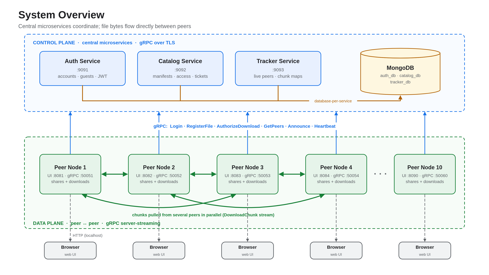
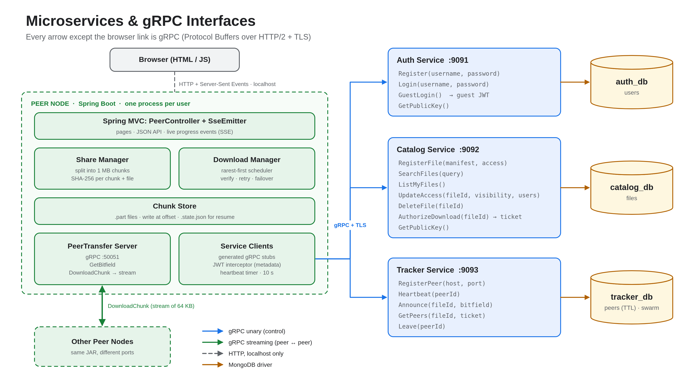
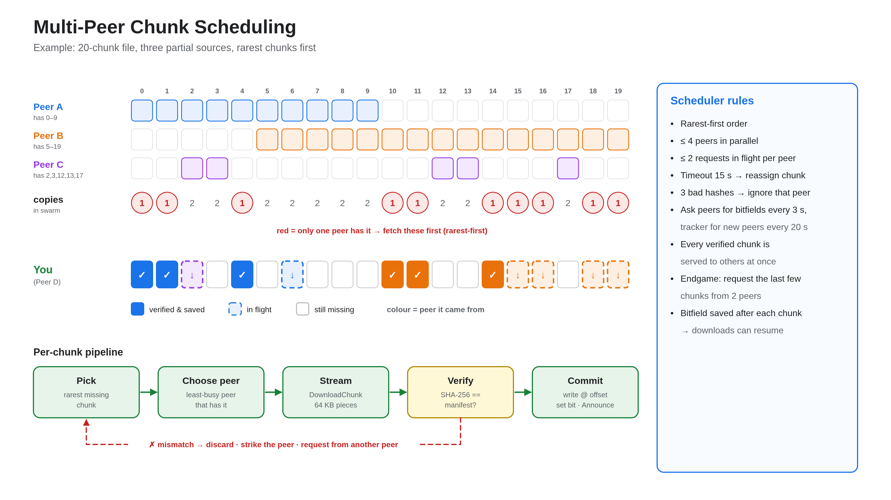

# Distributed P2P File Transfer System

Users share files, and other users download them **from several peers at the same time**, like BitTorrent.
A small set of central **microservices** decides who is allowed to get what and knows which peers have which pieces.
The file bytes themselves go **directly from peer to peer**, never through a server.



## Features
- **Parallel multi-peer downloads.** Files are split into 1 MB chunks. A downloader pulls different chunks from up to 4 peers at once, rarest chunks first. Every peer that has a chunk immediately serves it to others.
- **Resumable.** Progress is saved after every verified chunk. After a crash or restart, a download continues where it stopped.
- **Integrity.** Every chunk is checked with SHA-256, and the whole file is checked at the end. Bad chunks are thrown away and fetched from another peer. A peer that keeps sending bad data is ignored for 60 s.
- **Accounts and guests.** Register or log in, or continue as an anonymous guest.
- **Access control.** The owner picks who can find and download each file:

  | Visibility | Owner | Shared-with users | Other users | Guests |
  |---|:-:|:-:|:-:|:-:|
  | `PUBLIC` | ✓ | ✓ | ✓ | ✓ |
  | `REGISTERED` | ✓ | ✓ | ✓ | ✗ |
  | `PRIVATE` + list of usernames | ✓ | ✓ | ✗ | ✗ |

  Guests can only share `PUBLIC` files. Search never shows a file you can't download.
- **Secure.** TLS on every gRPC connection, bcrypt-hashed passwords, and signed JWTs for identity and for per-file "download tickets".
- **Web UI per peer.** Shows a live chunk map coloured by the peer each chunk came from, plus pause/resume, sharing and access settings.

## Technology

| Choice | Used | Why |
|---|---|---|
| Architecture | **Microservices** | Separate services for identity, file catalog and swarm tracking, each with its own database. They can be deployed and restarted independently. |
| Communication | **gRPC** (Protocol Buffers over HTTP/2 + TLS) | Binary, strongly typed contracts. Server streaming carries file chunks. Deadlines and interceptors are built in. |
| Database | **MongoDB** (one database per service) | A file manifest with its list of chunk hashes is naturally one document. A TTL index drops peers that stop sending heartbeats. |
| Framework | **Java 21 + Spring Boot 3.3** | `grpc-spring-boot-starter` (`@GrpcService`, `@GrpcClient`), Spring Data MongoDB, Spring MVC + Server-Sent Events for the UI |
| Security | JJWT (RS256), bcrypt, OpenSSL-generated local CA | |
| Build | Maven (wrapper included), JUnit 5 | |

The full design, including why these choices beat the alternatives (monolith, SOA, event-driven, REST, service mesh, MySQL), is in **[docs/ARCHITECTURE.md](docs/ARCHITECTURE.md)**.

## How it works

### Components
| Component | Port | Job |
|---|---|---|
| **Auth Service** | gRPC 9091 · `auth_db` | Register / log in (bcrypt) / guest login, and issues JWTs |
| **Catalog Service** | gRPC 9092 · `catalog_db` | Stores file manifests (name, size, SHA-256 of every chunk), checks access rules, handles search, and signs **Download Tickets** |
| **Tracker Service** | gRPC 9093 · `tracker_db` | Tracks which peers are online (10 s heartbeats) and which chunks each peer has (bitfields) |
| **Peer Node** (one per user) | UI 8080+N · gRPC 50050+N | Web UI, sharing, the parallel download engine, and a gRPC chunk server for other peers |



### Sharing a file
1. The user logs in (or continues as a guest) in their peer's web UI. The Auth service returns a JWT.
2. The peer splits the file into 1 MB chunks and hashes each one, plus the whole file.
3. `Catalog.RegisterFile` stores the manifest and the chosen visibility.
4. `Tracker.Announce` says "I have every chunk", so the peer is now a **seeder**.

### Downloading a file
1. `Catalog.AuthorizeDownload` checks access and returns the manifest plus a signed **Download Ticket** (valid 30 min).
2. `Tracker.GetPeers` returns the online peers that have chunks of the file.
3. The **scheduler** requests the rarest missing chunks first, from the least-busy peer that has them (at most 4 peers, 2 requests each).
4. `PeerTransfer.DownloadChunk` streams each chunk in 64 KB pieces. The receiver checks its SHA-256, writes it at its position in the file, saves progress, and tells the tracker.
5. When every chunk is present, the whole-file hash is checked and the download is **COMPLETED**. The peer keeps seeding.

The ticket is checked three times: by the Catalog when issuing it, by the Tracker before revealing who has the file, and by every peer before sending a chunk. Knowing a peer's address isn't enough to fetch a private file.



More diagrams (sequence diagrams, download state machine, data model, deployment) are in [docs/diagrams/png/](docs/diagrams/png/).

## Project layout
```
proto/            p2p.proto: every gRPC contract (Java stubs generated at build time)
common/           JWT + download tickets, RSA keys, auth interceptor, TLS channels, utilities
auth-service/     Spring Boot app: accounts, guests, JWTs
catalog-service/  Spring Boot app: manifests, AccessPolicy, search, tickets
tracker-service/  Spring Boot app: online peers, swarm bitfields
peer-node/        Spring Boot app: web UI, ChunkScheduler, DownloadTask, PeerTransfer server
scripts/          build, certificates, start/stop, demo helpers
docs/             ARCHITECTURE.md + diagram sources (SVG) and PNGs for slides
```

## Running it (one machine)

**Requirements:** Java 21 and Docker (used **only** for MongoDB). Maven is not needed, because `./mvnw` downloads it.

Run these from the project folder, in order:

1. Build all jars:
   ```bash
   ./mvnw -q package
   ```
2. Start MongoDB in Docker (`localhost:27017`):
   ```bash
   scripts/start-mongo.sh
   ```
3. Start the auth, catalog and tracker services. This also creates TLS certificates on first run.
   ```bash
   scripts/start-services.sh
   ```
4. Start 4 peers, each limited to 4 MB/s upload:
   ```bash
   scripts/start-peers.sh 4 4MB
   ```

Then open **http://localhost:8081**, **:8082**, **:8083**, **:8084**. Each tab is a different user's computer.
Create an account (or continue as a guest), share a file on one peer, and download it on the others.

The upload limit (e.g. `4MB`) slows each peer down so you can watch a download pull from several peers at once. On localhost, transfers would otherwise finish instantly.

To stop everything (MongoDB keeps running):
```bash
scripts/stop-all.sh
```

To stop MongoDB as well:
```bash
docker stop p2p-mongo
```

Logs are in `logs/<name>.log`. Each peer's files and progress are in `peers/peer-N/`.

### Demo helpers
- Crash a peer (SIGKILL), then watch the others carry on:
  ```bash
  scripts/kill-peer.sh 2
  ```
- Restart peer 2. Its download resumes from the saved progress:
  ```bash
  scripts/start-peers.sh 2-2 4MB
  ```
- Start a peer that sends corrupted chunks, to show the hash check catching them:
  ```bash
  scripts/start-peers.sh 5-5 4MB --peer.debug-corrupt=true
  ```

## Tests
```bash
./mvnw test
```
The unit tests cover the access rules (`AccessPolicyTest`), the rarest-first chunk scheduler (`ChunkSchedulerTest`) and bitfield encoding.
The full system was also tested end to end: multi-peer downloads with matching hashes, access control, crash and resume, corrupted-chunk detection, and recovery after a power cut.

## Limitations
- The central tracker is a single point of failure. A fix would be a replicated tracker or a DHT such as Kademlia.
- Built for one machine or a LAN. There is no NAT traversal for use across the internet.
- Files are not encrypted at rest.
