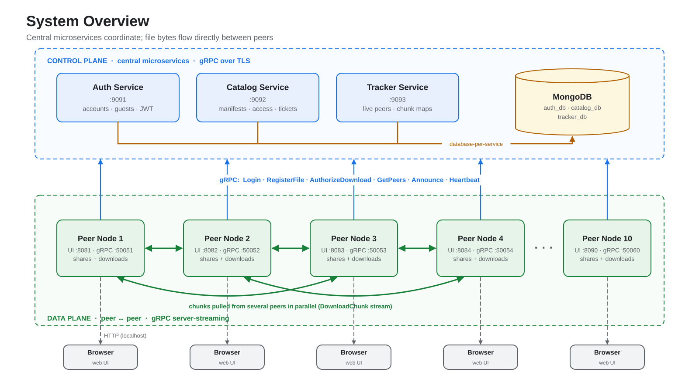
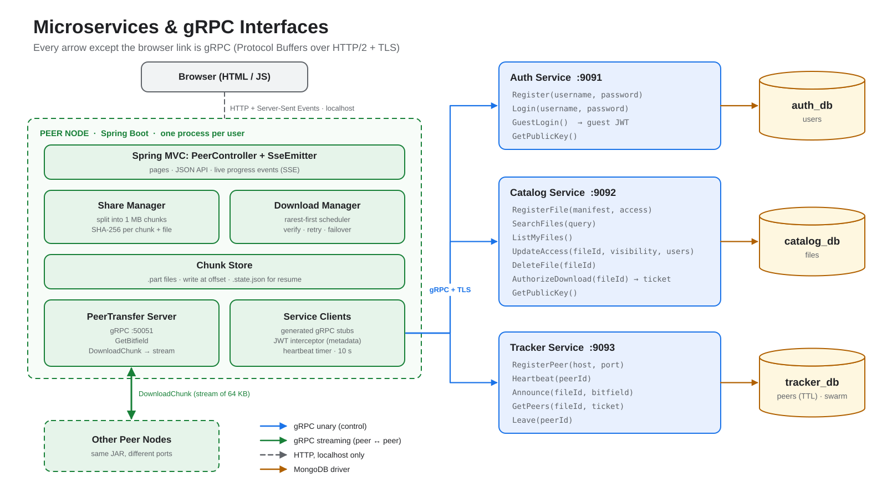
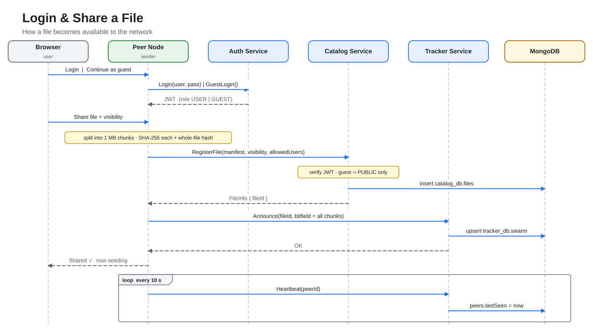
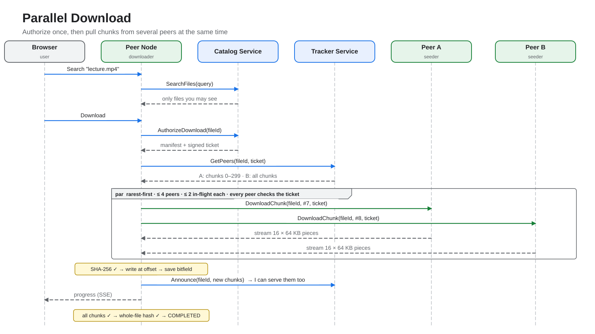
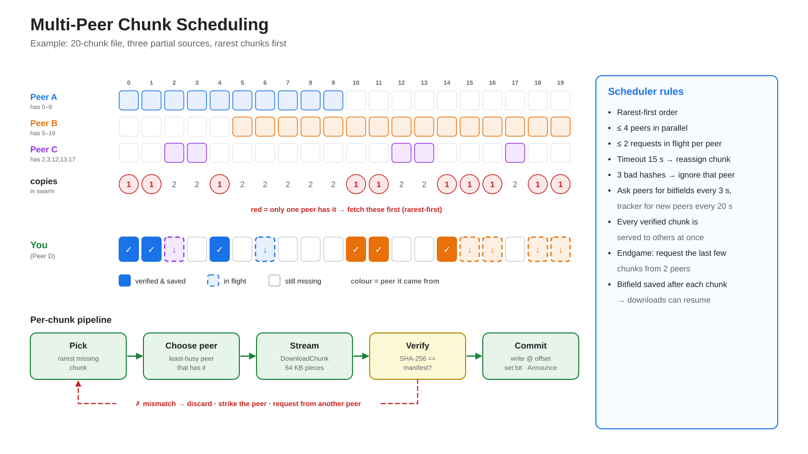
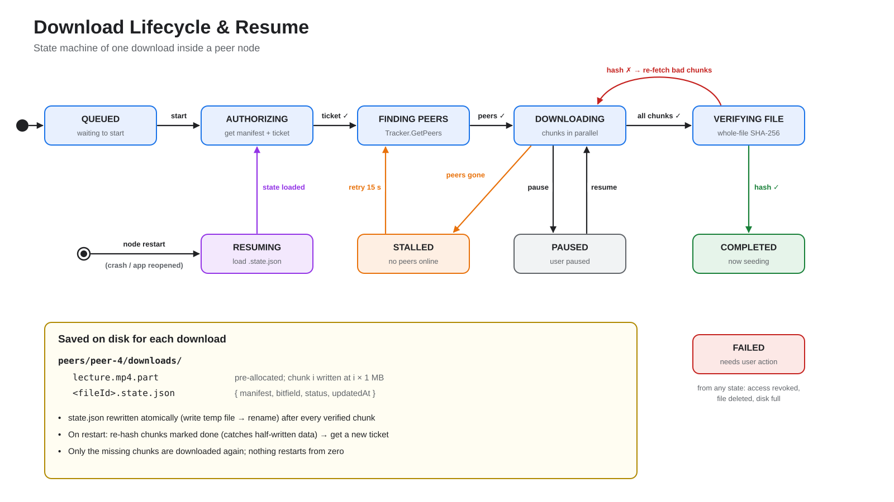
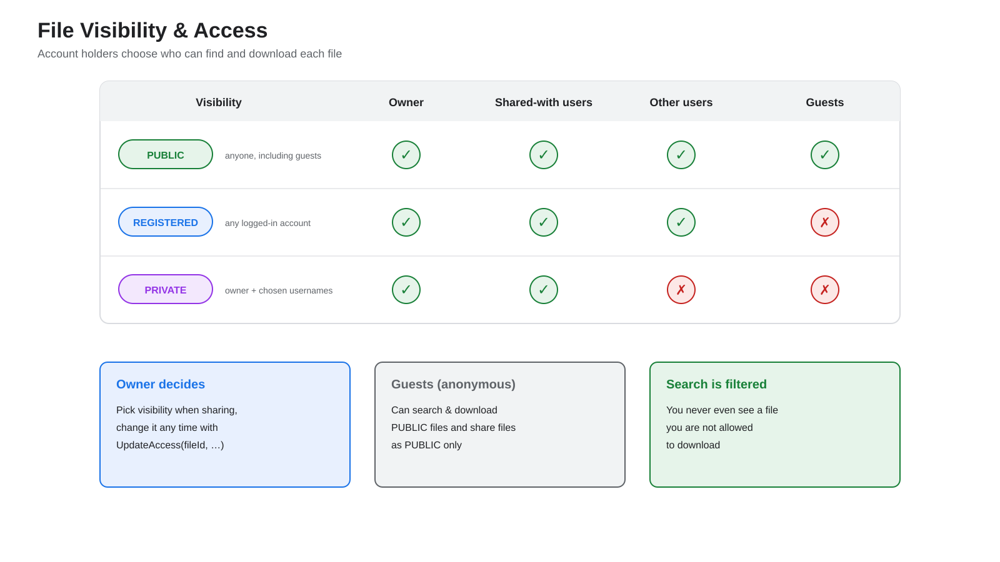
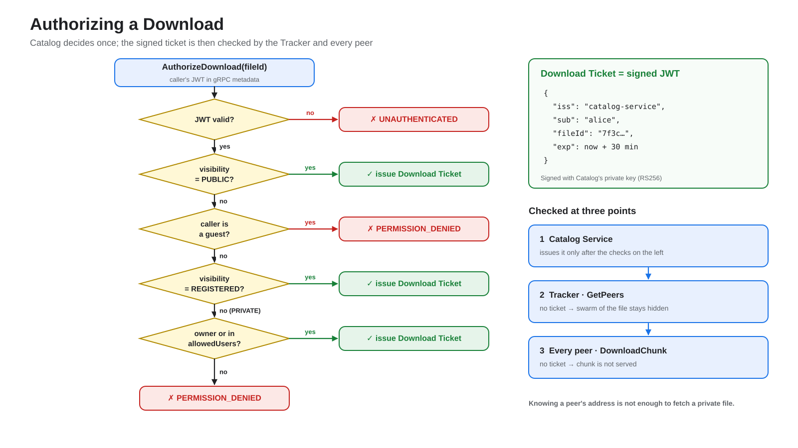
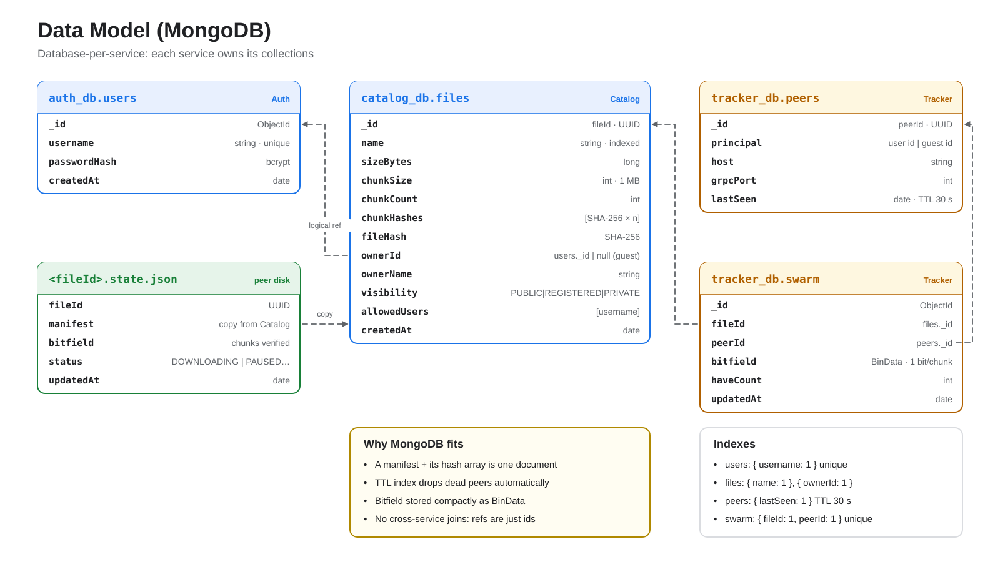
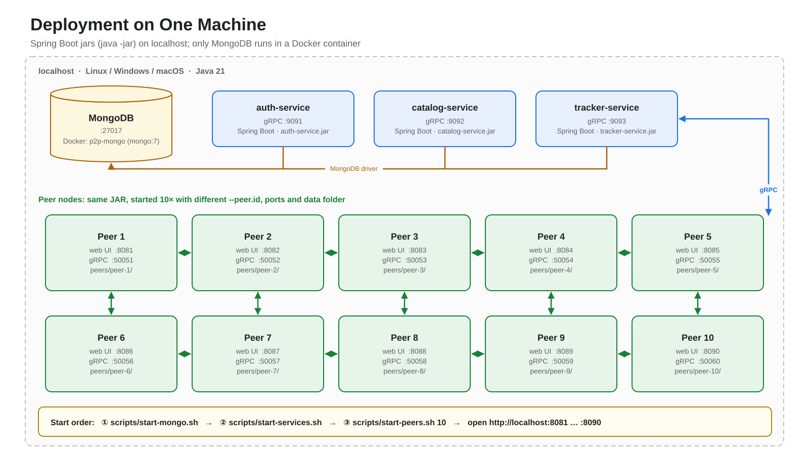

# Distributed P2P File Transfer System — Architecture

| Decision | Choice |
|---|---|
| Architecture style | **Microservices** |
| Communication | **gRPC** (Protocol Buffers over HTTP/2, TLS) |
| Database | **MongoDB** (one logical database per service) |
| Language / runtime | Java 21, **Spring Boot 3.3**: gRPC via `grpc-spring-boot-starter` (`@GrpcService` / `@GrpcClient`), **Spring Data MongoDB**, **Spring MVC** for the peer UI (~160 MB per process) |
| Client | Web UI served by each peer node |
| Peer discovery | Central tracker |
| Deployment | Single machine: Spring Boot jars run with `java -jar`; only MongoDB runs in a Docker container (`scripts/start-mongo.sh`) |
| Scale target | ~10 peers, files < 1 GB |

All diagrams are in [`diagrams/`](diagrams/) as SVG. Open [`diagrams/export.html`](diagrams/export.html) in a browser to download high-resolution PNGs for the slides. PNG copies are also in [`diagrams/png/`](diagrams/png/).

---

## 1. Core idea: control plane vs data plane



* **Control plane:** three central microservices. They handle *who you are*, *what files exist and who may get them*, and *which peers have which chunks*. They never see file contents.
* **Data plane:** peer nodes stream file chunks **directly to each other** over gRPC. A download pulls different chunks from several peers at the same time.

This is the main point for the presentation. The servers coordinate the transfer but don't carry the data, so adding peers adds bandwidth instead of adding server load.

---

## 2. Why these choices (slide material)

### Architecture style

| Option | Verdict | Reason |
|---|---|---|
| Monolithic | ✗ | Simplest option, but it puts identity, catalog and swarm state in one deployable unit. It can't scale or fail independently, and it shows little distributed design. |
| SOA | ✗ | Built around an enterprise service bus and shared contracts. Too heavyweight for 3 services. |
| Event-driven | ✗ | Needs a broker (Kafka/RabbitMQ) as extra infrastructure. Most interactions here are request/response (e.g. "give me peers for file X"), not fire-and-forget events. |
| Function-oriented (FaaS) | ✗ | Functions are short-lived and stateless. Peers need long-running servers that stream data and send heartbeats. |
| **Microservices** | ✓ | Clear bounded contexts (Auth, Catalog, Tracker), database-per-service, independent deploy/restart, failure isolation. A peer node is itself a small service. |

### Communication

| Option | Verdict | Reason |
|---|---|---|
| REST | ✗ | Text/JSON payloads, so binary chunks need base64 or a separate protocol. No enforced contract. No native streaming. |
| **gRPC** | ✓ | Binary Protobuf, HTTP/2 multiplexing, **server streaming** for chunk transfer, strongly-typed generated Java stubs, built-in deadlines, TLS and interceptors (for JWT). |
| Service mesh | ✗ | Not a protocol. It's infrastructure (Istio/Linkerd) that needs Kubernetes and sidecars, which doesn't fit a single machine with no containers. |

### Database

| Option | Verdict | Reason |
|---|---|---|
| MySQL | ✗ | Chunk-hash lists and per-peer bitfields would need extra join tables. Peer expiry needs a cron job. |
| **MongoDB** | ✓ | A file manifest (with an array of chunk hashes) is naturally one document. **TTL indexes** expire dead peers automatically. Flexible schema. Each service owns its own database. |

---

## 3. Components



### How it maps to Spring Boot
Every service and peer is its own Spring Boot application (its own jar, `application.yml` and port).

| Concern | Spring Boot building block |
|---|---|
| gRPC server | `@GrpcService` classes (`AuthServiceImpl`, `CatalogServiceImpl`, `TrackerServiceImpl`, `PeerTransferServiceImpl`), with TLS set in `grpc.server.security.*` |
| gRPC clients | `@GrpcClient("auth" / "catalog" / "tracker")` stubs, with addresses + TLS in `grpc.client.*`. Peer-to-peer channels are built at runtime, because peer addresses come from the tracker. |
| JWT check | `AuthInterceptor` registered as a `@GrpcGlobalServerInterceptor` |
| Error codes | `GrpcServerConfig` (shared): sends a thrown `StatusRuntimeException` to the client with its real code |
| Database | Spring Data MongoDB: `@Document` records (`User`, `FileRecord`, `PeerRecord`, `SwarmEntry`), `MongoRepository` interfaces, `MongoTemplate` for the access-filtered search |
| Background jobs | `@Scheduled`: tracker heartbeat (10 s), announcements (2 s), swarm cleanup (30 s), UI push (0.5 s) |
| Peer web UI | Spring MVC `@RestController` (`PeerController`), `SseEmitter` for live progress, static files in `src/main/resources/static/` |
| Configuration | `application.yml` + `PeerProperties` (`@ConfigurationProperties("peer")`), overridable with `--peer.x=...` |

The three services set `spring.main.web-application-type: none`: they only speak gRPC and don't start Tomcat, which saves memory.

### 3.1 Auth Service (`:9091`, db `auth_db`)
* `Register`, `Login`: account users. Passwords are hashed with bcrypt.
* `GuestLogin`: anonymous mode. Issues a JWT with `sub = guest-<uuid>` and `role = GUEST`.
* `GetPublicKey`: other services verify JWTs **locally** with this RSA public key, so they don't need a call to Auth on every request.

### 3.2 Catalog Service (`:9092`, db `catalog_db`)
* `RegisterFile`: stores the manifest (name, size, chunk size, SHA-256 of every chunk, whole-file hash) and access settings.
* `SearchFiles`, `ListMyFiles`: results are filtered by the caller's access rights.
* `UpdateAccess`, `DeleteFile`: owner only.
* `AuthorizeDownload`: checks access and returns the manifest plus a **Download Ticket**. The ticket is a short-lived JWT signed by the Catalog containing `fileId`, `userId` and `exp`.
* `GetPublicKey`: used by the Tracker and peers to verify tickets.

### 3.3 Tracker Service (`:9093`, db `tracker_db`)
* `RegisterPeer` / `Leave`: a peer comes online or goes offline.
* `Heartbeat`: sent every 10 s. A peer missing for 30 s is removed by a MongoDB TTL index.
* `Announce`: the peer reports which chunks of a file it has (a bitfield).
* `GetPeers(fileId, ticket)`: returns the live peers and their bitfields. **Requires a valid ticket**, so the swarm of a private file stays hidden.

### 3.4 Peer Node (one Java process per peer: UI `:8081…8090`, gRPC `:50051…50060`)
| Component | Responsibility |
|---|---|
| Web UI (HTML/JS) | Login / guest, share file, search, downloads with live chunk map, pause/resume |
| `PeerController` + `StateView` (Spring MVC) | Local HTTP JSON API + Server-Sent Events (`SseEmitter`) between the browser and its own node (see note below) |
| Share Manager | Splits a file into 1 MB chunks, hashes each with SHA-256, registers and announces it |
| Download Manager | Rarest-first scheduler, parallel requests to several peers, retry/failover |
| Chunk Store | `.part` files on disk, chunk read/write at offset, resume state |
| Service clients | gRPC stubs for Auth/Catalog/Tracker with a JWT interceptor |
| PeerTransfer gRPC server | Serves verified chunks to other peers after checking their ticket |

> **Why the browser uses HTTP:** browsers cannot speak native gRPC. The usual fixes are gRPC-Web plus an Envoy proxy, which is extra infrastructure. The UI is only a local presentation layer of the peer node (localhost). **All communication between services, and all peer-to-peer communication, is gRPC.**

---

## 4. Key flows

### 4.1 Login and sharing a file


1. The user logs in or continues as a guest, and the node stores the JWT.
2. The user picks a file and a visibility setting. The node splits it into 1 MB chunks and computes SHA-256 per chunk plus a whole-file hash.
3. `Catalog.RegisterFile` stores the manifest and returns a `fileId` (UUID).
4. `Tracker.Announce` tells the tracker this peer has every chunk, so it is now a **seeder**.
5. A heartbeat every 10 s keeps the peer alive in the tracker.

### 4.2 Parallel download



1. `Catalog.AuthorizeDownload` returns the manifest and a Download Ticket (valid 30 min, refreshed automatically).
2. `Tracker.GetPeers` returns the live peers with their bitfields.
3. The node pre-allocates `<fileId>.part` at the full file size.
4. **Scheduler (rarest-first):** count how many peers have each missing chunk and request the rarest first, so rare chunks spread before their only holder leaves. Each request goes to the least-busy peer that has the chunk. Limits are **≤ 4 peers** at once and **≤ 2 requests in flight per peer**.
5. `PeerTransfer.DownloadChunk` streams the 1 MB chunk in 64 KB pieces (gRPC server streaming).
6. Check the SHA-256 against the manifest:
   * **OK:** write the chunk at offset `index × 1 MB`, set its bit, save the state file, and add it to the next `Announce` batch. The downloader immediately starts **serving that chunk to others**.
   * **Mismatch:** discard the chunk, request it from a different peer, and give a strike to the sender (3 strikes means the peer is ignored).
7. On a timeout or a dropped peer, reassign the chunk. Every 3 s, ask the peers already known for their latest bitfield (`PeerTransfer.GetBitfield`), so peers downloading the same file trade chunks with each other right away. Every 20 s, ask the tracker for new peers.
8. When all bits are set, verify the whole-file hash and rename `.part` to the final file. The download is **COMPLETED** and the node stays a seeder.

### 4.3 Resume


* After every verified chunk, `<fileId>.state.json` (manifest + bitfield) is written atomically (write a temp file, then rename).
* **Pause:** in-flight requests are cancelled and the state is kept.
* **Crash or restart:** on startup the node loads every `.state.json`, re-hashes the chunks marked done (this catches torn writes), gets a fresh ticket, and continues with only the missing chunks.
* **All peers gone:** the download goes to `STALLED` and retries the tracker every 15 s.

---

## 5. Access control




| Visibility | Owner | Shared-with users | Other account users | Guests |
|---|---|---|---|---|
| `PUBLIC` | ✓ | ✓ | ✓ | ✓ |
| `REGISTERED` | ✓ | ✓ | ✓ | ✗ |
| `PRIVATE` (+ `allowedUsers`) | ✓ | ✓ | ✗ | ✗ |

* Account owners choose visibility on upload and can change it later (`UpdateAccess`).
* Guests can only share `PUBLIC` files, because there is no identity to restrict them to.
* **Defense in depth:** the ticket is checked at 3 points: Catalog issues it, Tracker requires it for `GetPeers`, and each peer requires it for `DownloadChunk`. A peer that learns another peer's address still can't download a private file without a ticket.

### Security summary
| Threat | Mitigation |
|---|---|
| Password theft from DB | bcrypt hashes |
| Impersonation | RS256-signed JWTs, verified in a gRPC `ServerInterceptor` |
| Unauthorized download | Catalog-signed Download Tickets checked by Tracker and every peer |
| Corrupted / malicious chunk | SHA-256 per chunk + whole-file hash, peer strike list |
| Eavesdropping | TLS on every gRPC channel (self-signed local CA from `scripts/gen-certs.sh`) |

---

## 6. Data model



```js
// auth_db.users
{ _id, username /*unique*/, passwordHash, createdAt }

// catalog_db.files
{ _id: "uuid", name, sizeBytes, chunkSize: 1048576, chunkCount,
  chunkHashes: ["sha256…", …], fileHash,
  ownerId /* null for guest */, ownerName,
  visibility: "PUBLIC" | "REGISTERED" | "PRIVATE", allowedUsers: ["alice", …],
  createdAt }
// indexes: name, ownerId (search = case-insensitive substring)

// tracker_db.peers
{ _id: peerId, principal, host, grpcPort, lastSeen }   // TTL index on lastSeen: 30 s

// tracker_db.swarm
{ fileId, peerId, bitfield: BinData, haveCount, updatedAt }
// indexes: {fileId:1}, unique {fileId:1, peerId:1}
```

There are no foreign keys across services. `files.ownerId` refers to `users._id` *logically*, which is normal with database-per-service.

---

## 7. gRPC contracts (sketch)

```proto
syntax = "proto3";
package p2p.v1;
option java_multiple_files = true;
option java_package = "com.p2p.proto";

// JWT is sent in gRPC metadata: "authorization: Bearer <jwt>"

service AuthService {
  rpc Register     (RegisterRequest)  returns (AuthResponse);
  rpc Login        (LoginRequest)     returns (AuthResponse);
  rpc GuestLogin   (Empty)            returns (AuthResponse);
  rpc GetPublicKey (Empty)            returns (PublicKey);
}

service CatalogService {
  rpc RegisterFile      (RegisterFileRequest) returns (FileInfo);
  rpc SearchFiles       (SearchRequest)       returns (SearchResponse);
  rpc ListMyFiles       (Empty)               returns (SearchResponse);
  rpc UpdateAccess      (UpdateAccessRequest) returns (FileInfo);
  rpc DeleteFile        (FileId)              returns (Empty);
  rpc AuthorizeDownload (FileId)              returns (DownloadGrant); // manifest + ticket
  rpc GetPublicKey      (Empty)               returns (PublicKey);
}

service TrackerService {
  rpc RegisterPeer (PeerInfo)         returns (PeerSession);
  rpc Heartbeat    (PeerId)           returns (HeartbeatAck);
  rpc Announce     (AnnounceRequest)  returns (Empty);
  rpc GetPeers     (GetPeersRequest)  returns (GetPeersResponse);
  rpc Leave        (PeerId)           returns (Empty);
}

service PeerTransferService {
  rpc GetBitfield   (BitfieldRequest) returns (Bitfield);
  rpc DownloadChunk (ChunkRequest)    returns (stream ChunkPiece); // 64 KB pieces
}

enum Visibility { VISIBILITY_UNSPECIFIED = 0; PUBLIC = 1; REGISTERED = 2; PRIVATE = 3; }

message Manifest {
  string file_id = 1; string name = 2; int64 size_bytes = 3;
  int32 chunk_size = 4; int32 chunk_count = 5;
  repeated bytes chunk_hashes = 6; bytes file_hash = 7;
}
message DownloadGrant { Manifest manifest = 1; string ticket = 2; int64 expires_at = 3; }
message ChunkRequest  { string file_id = 1; int32 index = 2; string ticket = 3; }
message ChunkPiece    { int32 index = 1; int64 offset = 2; bytes data = 3; bool last = 4; }
message PeerEndpoint  { string peer_id = 1; string host = 2; int32 port = 3; bytes bitfield = 4; }
```

---

## 8. Deployment on one machine



| Process | Port(s) | Data |
|---|---|---|
| MongoDB (Docker container `p2p-mongo`) | 27017 | `auth_db`, `catalog_db`, `tracker_db` (volume `p2p-mongo-data`) |
| auth-service | gRPC 9091 | |
| catalog-service | gRPC 9092 | |
| tracker-service | gRPC 9093 | |
| peer-node ×10 | UI 8081–8090, gRPC 50051–50060 | `peers/peer-N/{shared,downloads,state}` |

Start order: `scripts/start-mongo.sh`, then `scripts/start-services.sh`, then `scripts/start-peers.sh 10`. Each peer is the same JAR started with a different `--peer.id`, ports and data folder.

### Repository layout
```
p2p-file-transfer/
├── pom.xml                 # Maven parent (use ./mvnw — Maven isn't installed globally)
├── mvnw                    # Maven wrapper
├── proto/                  # .proto files → generated Java stubs (shared)
├── common/                 # JWT utils, TLS config, gRPC interceptors
├── auth-service/
├── catalog-service/
├── tracker-service/
├── peer-node/              # web UI + download manager + PeerTransfer server
├── scripts/                # build, gen-certs, start-services, start-peers, stop-all, kill-peer
└── docs/                   # this document + diagrams
```

---

## 9. Demo script for the presentation
On localhost, transfers finish too fast to see, so each peer has an **upload rate limit flag** (e.g. `--peer.upload-limit=2MB/s`).

1. `scripts/start-services.sh`, then `scripts/start-peers.sh 4 2MB`. Peer 1 logs in as `alice` and shares a 300 MB video as `PUBLIC`.
2. Peers 2–3 download it. The chunk map shows them pulling from Peer 1 **and from each other**.
3. Peer 4 downloads with 3 sources: the chunk map is coloured by source peer.
4. **Kill Peer 2** mid-transfer (`scripts/kill-peer.sh 2`): its chunks are reassigned and the download continues.
5. **Kill Peer 4** itself (`scripts/kill-peer.sh 4`), restart it (`scripts/start-peers.sh 4-4 2MB`): it resumes from the saved bitfield, not from zero.
6. Alice shares a `PRIVATE` file with `bob`. A guest searches and can't see it. Bob can download it.
7. Start a seeder with `--peer.debug-corrupt=true` (e.g. `scripts/start-peers.sh 5-5 2MB --peer.debug-corrupt=true`): the hash mismatch is detected, the chunk is re-fetched elsewhere, and that peer gets a strike.

---

## 10. Limitations and future work
* The tracker is a single point of failure. Fixes: run a tracker replica set, or replace the tracker with a DHT (Kademlia).
* No NAT traversal (not needed on one machine). Real internet use needs STUN/TURN or relay peers.
* Files are not encrypted at rest. A possible addition is end-to-end encryption, with keys shared through the Catalog for private files.
* No incentive mechanism (e.g. BitTorrent's tit-for-tat) to stop peers that download without uploading.
